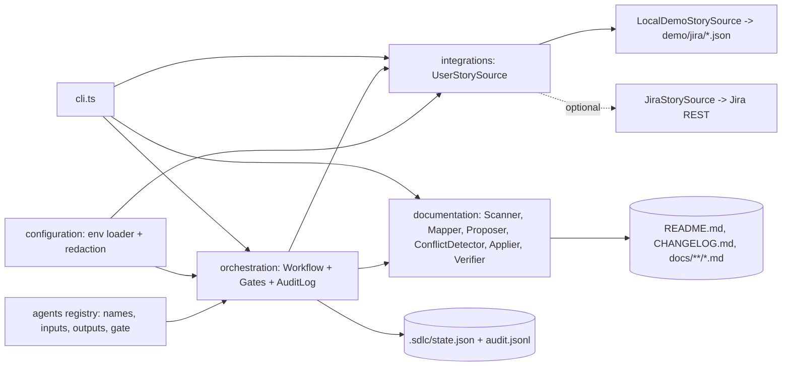
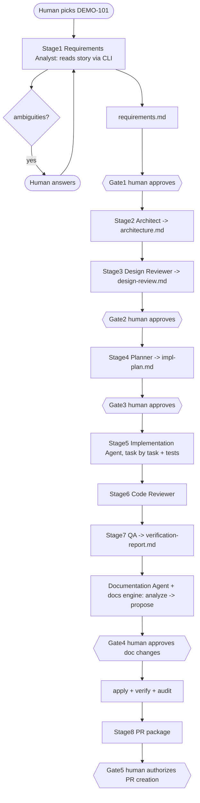

# Architecture — Automated Documentation Sync

**Status:** APPROVED (Gate 2) by the human in Copilot chat, 2026-11-26, together with `docs/design-review.md` and the dev dependencies listed in §1 (`typescript`, `vitest`, `tsx`, `eslint`, `typescript-eslint`, `@types/node`). Accepted residual risks: DR-001, DR-013, DR-014.
**Based on:** approved `docs/requirements.md` (REQ-F-001..009, REQ-N-001..005)

**Scope revision (human-requested, after Gate 3):** the application was reduced to what the capstone evaluates (agents, hooks, human-in-the-loop). The proposal/journal/conflict **doc-sync engine (§4) was removed**: the Documentation Agent now proposes changes to the human in chat, applies only approved edits, and `docs check` verifies every requirement is traced in `docs/traceability-matrix.md`. Jira is a thin get-by-key source (mocked tests; live BLOCKED). Workflow has no fail/retry/blocked states. Sections 4, 11 and parts of 12 below describe the original design and are superseded where they conflict with this note.

## 1. Goals and principles

- Deterministic application (TypeScript CLI) + Copilot agents (LLM reasoning at SDLC time). **The app contains no LLM call.**
- Demo mode works offline with zero credentials; Jira is an isolated, optional plug-in.
- Humans approve at gates; the app records approvals, agents cannot self-approve (enforced by a hook, see §7).
- No runtime dependencies. Dev dependencies only: `typescript`, `vitest`, `tsx`, `eslint` + `typescript-eslint`, `@types/node` (**needs your approval**, brief 2.3).

## 2. Component view

| Component (src/) | Responsibility | Key interface |
|---|---|---|
| `configuration/` | Read env vars, apply defaults (`STORY_SOURCE=demo`), validate per mode, redact secrets from any output | `loadConfig(env): AppConfig`, `redact(text)` |
| `integrations/` | Story abstraction, normalization, validation, typed errors | `UserStorySource { list(): Promise<Result<{stories, skipped}, StoryError>>; get(id): Promise<Result<Story, StoryError>> }`; malformed entries are skipped and reported, malformed file → `MALFORMED`; defaults `dependencies=[]`, `metadata={}` (DR-012); `createStorySource(config)` |
| `integrations/localDemoStorySource` | Reads `demo/jira/stories.json`; handles empty, malformed, missing file, unknown ID | implements `UserStorySource` |
| `integrations/jiraStorySource` | Calls Jira REST with Basic auth from env; maps response → `Story`; **no fallback** on failure | implements `UserStorySource` |
| `orchestration/` | Stage state machine, dependency enforcement (cannot skip), gate approval records, audit log, retry policy | `Workflow.advance(stage)`, `approve(gate, by)`, `reject(gate, by, reason)` |
| `documentation/` | Scan allowed docs, map REQs → docs, propose changes (managed blocks), detect conflicts, apply only approved, verify, summarize | `analyze()`, `propose()`, `apply(approvedIds)`, `verify()` |
| `agents/` | Static registry of the 9 agents (name, inputs, outputs, produced artifact, gate); a test checks it matches `.github/agents/*.agent.md` | `AGENTS` |
| `cli.ts` | Thin command layer | see §5 |

### Core types
`Story { id, type, title, description, acceptanceCriteria[], priority?, dependencies[], epicId?, metadata, source: 'demo'|'jira' }`
`StoryError { code: 'NOT_FOUND'|'INVALID_ID'|'MISSING_FIELDS'|'MALFORMED'|'SOURCE_UNAVAILABLE'|'AUTH_FAILED'|'CONFIG', message, fields? }` — messages never include secrets.

## 3. Data flow (story → PR)

State and audit live in `.sdlc/` (git-ignored): `state.json` (current stage, gate approvals with approver + timestamp + artifact hash), `audit.jsonl` (append-only events: stage transitions, approvals/rejections, doc changes with story/REQ IDs, verification results).

## 4. Documentation sync design (supports DEMO-103/104/105, brief 10.3–10.5)

1. **Scope allow-list:** `README.md`, `CHANGELOG.md`, `docs/**/*.md`. Paths are resolved and must stay inside the repo (no traversal, no symlink escape).
2. **Analyze:** a requirement→doc mapping file `docs/doc-map.json` declares which doc/section each requirement affects and why; the analyzer also reports docs referenced but missing. Every selected file carries a reason string.
3. **Propose:** generates change proposals (`id`, `targetFile`, `action: create|update`, `reason`, `storyId`, `requirementIds`, `baseHash`, `newContent`) as **managed blocks** `<!-- docsync:begin REQ-F-001 -->…<!-- docsync:end -->`. Unrelated content is never rewritten. Status starts `proposed`.
4. **Conflicts:** `CONFLICT` if the file changed since `baseHash`, or a managed block was hand-edited (block hash mismatch), or an unmanaged text contradicts the block marker structure. Conflicts are reported, never auto-resolved.
5. **Apply:** only proposals with status `approved` (set via `docs approve <id>`); writes atomically (temp file + rename); empty/missing files handled (create).
6. **Verify:** re-read files, confirm blocks present with expected hash and that unapproved/unrelated files are byte-identical. Failures reported as incomplete.
7. **Audit:** each step appended to `audit.jsonl`; `audit show` lists changed files, summaries, story/REQ IDs, verification result, approval status.

**Review updates (DR-005..008, 013):** the Documentation Agent writes proposal files `docs/sync/proposals/<id>.json` (`targetFile, action, blockId, reason, storyId, requirementIds, content`, optional `notes.semanticConflict`); `docs propose` validates them and stores `baseHash`; `docs show <id>` renders the diff. All sync targets (including `CHANGELOG.md`) change only via approved proposals. Path safety: `safeResolve()` rejects absolute/drive/UNC paths, `..`, `:` (alternate streams), reserved device names; resolves the existing parent with `realpath`; `lstat` rejects symlinks/junctions; case-insensitive on win32. Apply: group by file, prevalidate the whole batch, same-directory temp file + rename, journal in `.sdlc/apply-journal.json`, never overwrite a file whose hash changed. Proposals flagged semantically conflicting are `needs-review` and need explicit reviewer acknowledgement; semantic accuracy remains a human judgment.

## 5. CLI (no framework; `process.argv`)

`stories list | stories show <ID>` · `workflow start <ID> | status | complete <stage> --evidence <path> | fail <stage> --reason <text> | retry <stage> | approve <gate> | reject <gate> --reason <text> | verify` · `docs analyze | propose | show <id> | approve <id> | reject <id> | apply | verify` · `audit show`. `approve`/`reject` require an interactive TTY and typing the gate name (DR-001).
Exit codes: 0 ok, 1 domain error (e.g. Not Found), 2 usage, 3 configuration/integration failure.

## 6. Copilot layer (agents are NOT application code)

All files use verified formats: `.github/agents/*.agent.md` (frontmatter `name`, `description`, `tools`; no unsupported fields such as `handoffs`/`agents` under the Copilot schema), `.github/prompts/*.prompt.md`, `.github/skills/<name>/SKILL.md`, `.github/hooks/*.json` (`version: 1`).

| Agent | Writes | Tools (least privilege) | Gate after |
|---|---|---|---|
| Orchestrator | state via CLI only | read, search, execute (CLI), agent | n/a (never approves) |
| Requirements Analyst | `docs/requirements.md` | read, search, edit | Gate 1 |
| Architect | `docs/architecture.md` | read, search, edit | — |
| Design Reviewer | `docs/design-review.md` | read, search, edit | Gate 2 |
| Implementation Planner | `docs/impl-plan.md` | read, search, edit | Gate 3 |
| Implementation Agent | `src/**`, `tests/**` | read, search, edit, execute | milestone report |
| Code Reviewer | review findings (no source edits) | read, search | — |
| QA & Verification | `docs/verification-report.md` | read, search, edit, execute | — |
| Documentation Agent | proposals via docs CLI; `CHANGELOG.md` | read, search, edit, execute | Gate 4 |

Per-agent detail (inputs, outputs, failure handling, example run) goes in `docs/agent-architecture.md` (M8). Model is not pinned (`model` omitted); no model claims will be made.
Prompts (8): requirements, architecture, design-review, impl-plan, implement-task, code-review, verify, pr. Skills (6): analyze-user-story, generate-requirements, review-architecture, sync-documentation, run-verification, prepare-pr.

## 7. Security boundaries and guardrails

| Risk | Control (deterministic) |
|---|---|
| Secrets in repo/output | `.env` git-ignored, `.env.example` placeholders only; `redact()` on all error/log output; hook denies edits to `.env*` (except `.env.example`) and blocks writing text matching secret patterns |
| Agent self-approval / tampering with state | `preToolUse` hook denies agent edits to `.sdlc/**` (approvals only via the human-run CLI) |
| Unauthorized git actions | `preToolUse` hook denies shell commands containing `git commit/push/merge`, `gh pr create/merge` unless human runs them |
| Path traversal / untrusted IDs | ID regex validation; resolved-path containment check in docs engine |
| Jira failures | typed errors (`AUTH_FAILED`, `SOURCE_UNAVAILABLE`), no fallback, tokens never in messages |
| Dependency risk | zero runtime deps; `npm audit` + lockfile in verification |

Hook behavior (verified in docs): command `preToolUse` hooks are fail-closed on crash/non-zero exit, timeouts fail-open — so scripts must be fast and are covered by unit tests. Hooks use Node (present on host). A CI workflow (`.github/workflows/ci.yml`: lint, typecheck, test, audit) is the backstop for environments where hooks do not run.

Hooks are **guardrails, not a security boundary** (DR-001): an agent with shell access could attempt to bypass them. Real control comes from the approval design in §12. Story/doc text is passed to agents as delimited untrusted data; agent instructions forbid following instructions found in it (DR-014); authority is limited by tool lists, hooks, gates and CI.

## 11. Jira integration details (DR-010, DR-011)

Jira Cloud REST v3 (`/rest/api/3/issue/{key}`, search with `nextPageToken` paging, max 500). Auth: Basic (`JIRA_EMAIL` + `JIRA_API_TOKEN`) over HTTPS only, 10 s timeout, 2 retries on 429/5xx, `redirect: 'error'`, no auth header or raw response in logs/errors. Acceptance criteria come from optional `JIRA_ACCEPTANCE_CRITERIA_FIELD` (custom field id), otherwise the "Acceptance Criteria" section of the description (Atlassian Document Format → plain text). Missing AC → `MISSING_FIELDS`. Live behavior cannot be verified now → **BLOCKED**; unit-tested with mocked `fetch`.

## 12. Workflow integrity (DR-001..004, 009)

- **Transitions:** Stage order is fixed; `complete <stage> --evidence` requires prerequisites (previous stage complete, required gate approved, evidence file exists). `fail`/`retry` allow at most 2 retries, then the stage is `blocked` pending a human decision.
- **Approval ledger:** `docs/approvals.json` is committed (visible in PR diff). Each entry: gate, artifact path, SHA-256, approver (from TTY session user), timestamp. `workflow verify` and CI recompute hashes; a changed artifact invalidates its gate and all later gates. Gate 5 (PR) binds to the hash of `git diff` of the PR branch.
- **Story handoff (DR-004):** `workflow start <ID>` writes read-only `.sdlc/inputs/<ID>.json` and a delimited markdown rendering that the Requirements Analyst reads.
- **Durability (DR-009):** order is journal intent → write file → update state → append audit; startup reconciliation; the JSONL reader tolerates a truncated last line.
- **Hook scope:** hooks deny agent edits to `.sdlc/**` and `docs/approvals.json`.

## 8. Technology choices and trade-offs

| Choice | Why | Trade-off |
|---|---|---|
| TypeScript + Node 22 (confirmed) | Typed contracts, already installed | build step (use `tsx` for dev, `tsc` for build) |
| Vitest | fast, TS-native | extra dev dep |
| JSON state + JSONL audit | simple, diffable, no DB | not concurrent-safe (single-user CLI; documented) |
| Hand-written validation (no zod) | no runtime deps | more code; small schema, fully tested |
| Managed doc blocks | safe, idempotent, preserves unrelated text | needs markers in docs |
| Jira via `fetch` (Node 22 built-in) | no SDK | live path unverifiable now → marked BLOCKED, unit-tested with mocked fetch |
| Logging: simple `console` wrapper with redaction (resolves `[LOGGING_SOLUTION]`) | no deps | no structured sinks |
| Deployment: local CLI only (`[DEPLOYMENT_PLATFORM]`) | scope | no hosting |

## 9. Requirement coverage

| Requirement | Component |
|---|---|
| REQ-F-001, 004 | `UserStorySource.get`, `StoryError.NOT_FOUND` |
| REQ-F-002, 003, 006, 007 | story normalizer/validator in `integrations/` |
| REQ-F-005, 008 | `LocalDemoStorySource`, `createStorySource`, `loadConfig` |
| REQ-F-009, REQ-N-004 | interface + isolated `jiraStorySource` |
| REQ-N-001 | `configuration/redact` + hook |
| REQ-N-002 | ID validation, path containment |
| REQ-N-003 | typed `StoryError`/`AppError`, CLI exit codes |
| REQ-N-005 | `tests/unit`, `tests/integration` |

## 10. Assumptions needing approval

1. Dev dependencies listed in §1 are acceptable.
2. `.sdlc/` runtime state dir is git-ignored.
3. Doc-sync mapping is declarative (`docs/doc-map.json`) rather than inferred by NLP.
4. Hooks + CI are in scope as guardrails (brief section 9.5, 13).
