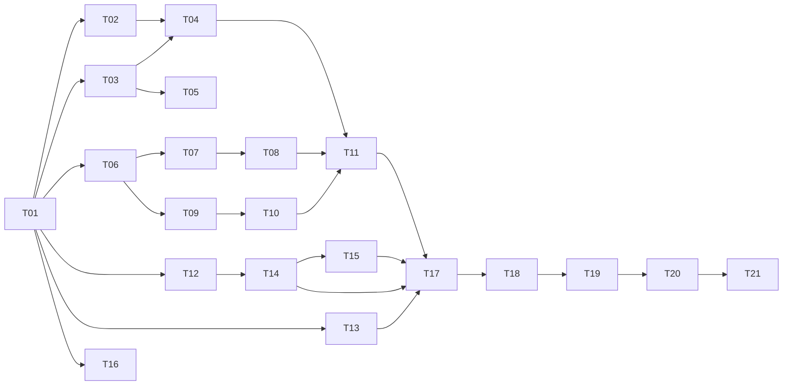

# Implementation Plan — Automated Documentation Sync

**Status:** APPROVED (Gate 3) by the human in Copilot chat, 2026-11-26. Task statuses below are updated as work completes.
**Inputs:** approved `docs/requirements.md`, approved `docs/architecture.md`, `docs/design-review.md`
**Rules:** one task at a time; read requirements + architecture; add tests; run tests; inspect diff; report evidence; update status here. No commits (human commits). All tasks start `Pending`.

**Scope revision:** T09/T10 (doc-sync engine) were replaced by `src/documentation/docCheck.ts` (`docs check`); T05 Jira reduced to get-by-key; T08 has no fail/retry; T16 CI and T13 hooks: hook done, CI workflow dropped. Status below reflects the revised scope.

## Dependency overview

Parallelizable after dependencies are met: {T02, T03, T06}, {T04, T05}, {T07, T09}, {T12, T13, T16}. Blocked externally: live Jira verification (no Jira project/credentials) — T05 live tests are BLOCKED; unit tests with mocked `fetch` are not.

## Tasks

| ID | Task | Pri | Depends on | Status |
|---|---|---|---|---|
| T01 | Project scaffold (npm, TS, Vitest, ESLint, .gitignore) | P0 | — | Done |
| T02 | Configuration loader, secret redaction, logger | P0 | T01 | Done |
| T03 | Story model, ID validation, normalizer/validator, `Result`/`StoryError` | P0 | T01 | Done |
| T04 | `LocalDemoStorySource` + `createStorySource` | P0 | T02, T03 | Done |
| T05 | `JiraStorySource` (mocked-fetch tested) | P1 | T02, T03 | Done (live: BLOCKED) |
| T06 | FS utilities: `safeResolve`, SHA-256, atomic write | P0 | T01 | Done |
| T07 | State store, audit log (JSONL), approvals ledger | P0 | T06 | Pending |
| T08 | Workflow state machine + gates + retry | P0 | T07 | Pending |
| T09 | Doc engine: scanner, doc-map, proposal schema, `propose` | P0 | T06 | Pending |
| T10 | Doc engine: conflicts, batch apply + journal, verify, summary | P0 | T09 | Pending |
| T11 | CLI (`src/cli.ts`) wiring all commands | P0 | T04, T08, T10 | Pending |
| T12 | Agents registry (`src/agents`) | P1 | T01 | Pending |
| T13 | Hooks: guard script + `.github/hooks/*.json` | P0 | T01 | Pending |
| T14 | `copilot-instructions.md` + 9 custom agents; registry consistency test | P0 | T12 | Pending |
| T15 | 8 prompts + 6 skills | P1 | T14 | Pending |
| T16 | CI workflow (lint, typecheck, test, audit, approvals verify) | P1 | T01 | Pending |
| T17 | Docs: README, agent-architecture, traceability matrix, CHANGELOG, `doc-map.json`, demo script | P0 | T11, T13, T14, T15 | Pending |
| T18 | Integration tests + scripted end-to-end demo run | P0 | T17 | Pending |
| T19 | Stage 6 code review (checklist from brief), fix Critical/High | P0 | T18 | Pending |
| T20 | Stage 7 verification → `docs/verification-report.md` (real output only) | P0 | T19 | Pending |
| T21 | Stage 8 PR package (title, 5 sections, changelog, checklist) — **no PR created without your authorization** | P0 | T20 | Pending |

## Task details

**T01 Scaffold.** Files: `package.json` (scripts: `build`, `test`, `lint`, `typecheck`, `cli`; `"type": "module"`, `engines.node >=22`), `package-lock.json`, `tsconfig.json` (strict), `vitest.config.ts`, `eslint.config.js`, `.gitignore` (add `node_modules/`, `dist/`, `coverage/`, `.sdlc/`, `*.log`, `.env.*` with `!.env.example`). *Accept:* `npm ci`, `npm run typecheck`, `npm run lint`, `npm test` run (empty suite passes). *Tests:* smoke test. Covers: REQ-N-005.

**T02 Configuration.** Files: `src/configuration/{config,redact,logger}.ts`; `tests/unit/config.test.ts`. *Accept:* default `STORY_SOURCE=demo`; `jira` without required vars → `CONFIG` error naming missing variables (not values); invalid `STORY_SOURCE` rejected; `redact()` masks known secret env values and token patterns; logger never prints secrets. *Tests:* defaults, missing Jira vars, invalid value, redaction. Covers: REQ-F-008, REQ-N-001, REQ-N-003.

**T03 Story model.** Files: `src/integrations/{types,errors,validation}.ts`; `tests/unit/validation.test.ts`. *Accept:* ID regex per Q6 (reject traversal/whitespace/empty); required fields `id,title,description,non-empty acceptanceCriteria` reported by name; defaults `dependencies=[]`, `metadata={}`; `Result` type. *Tests:* valid, each missing field, empty AC, invalid ID, malformed types. Covers: REQ-F-002, 003, 006, N-002, N-003.

**T04 Local demo source.** Files: `src/integrations/{localDemoStorySource,factory}.ts`; `tests/unit/localDemoSource.test.ts`; `tests/fixtures/*`. *Accept:* get by ID; `NOT_FOUND`; `list()` returns stories + `skipped`; empty collection OK; missing file → `SOURCE_UNAVAILABLE`; malformed JSON → `MALFORMED`; `source:'demo'` recorded; no network. Factory returns Jira only when `STORY_SOURCE=jira`. Covers: REQ-F-001, 002, 004, 005, 006, 007, 008, 009.

**T05 Jira source.** Files: `src/integrations/jiraStorySource.ts`; `tests/unit/jiraSource.test.ts` (mocked fetch). *Accept:* per architecture §11 (HTTPS, timeout, bounded retry, `redirect:'error'`, paging, ADF→text, AC field/description section, 401/403 → `AUTH_FAILED`, 404 → `NOT_FOUND`, network → `SOURCE_UNAVAILABLE`, no secret in any error, no fallback to demo). *Tests:* each status, malformed body, missing AC, token redaction. Live test: **BLOCKED**. Covers: REQ-F-008, 009, N-001, N-004.

**T06 FS utilities.** Files: `src/documentation/fsSafe.ts` (`safeResolve`, `sha256`, `atomicWrite`); `tests/unit/fsSafe.test.ts`. *Accept:* per DR-007 rules; atomic write via same-dir temp + rename. *Tests:* traversal, absolute, drive/UNC, `:` stream, reserved names, symlink (skipped with note if privilege lacking), atomic write, missing parent. Covers: REQ-N-002.

**T07 State/audit/ledger.** Files: `src/orchestration/{stateStore,auditLog,approvals}.ts`; tests. *Accept:* `.sdlc/state.json`; append-only `audit.jsonl` tolerating truncated last line; `docs/approvals.json` entries with artifact SHA-256; tamper detection. Covers: DEMO-105 audit; arch §12.

**T08 Workflow.** Files: `src/orchestration/workflow.ts`; tests. *Accept:* fixed stage order; cannot skip; gates 1–5 required where defined; `approve/reject` need TTY + typed gate name (injectable for tests); artifact change invalidates gate and later gates; `fail/retry` max 2 then `blocked`; transitions audited. Covers: orchestrator responsibilities (brief 6.1, 7).

**T09 Doc analysis/propose.** Files: `src/documentation/{scanner,docMap,proposal}.ts`, `docs/doc-map.json`; tests. *Accept:* allow-list scope; reasons per file; missing docs reported; proposal JSON schema validation; `baseHash` stored; empty/missing target handled. Covers: DEMO-103; REQ via doc-map.

**T10 Doc apply/verify.** Files: `src/documentation/{conflicts,apply,verify,summary}.ts`; tests. *Accept:* only `approved` applied; managed blocks `<!-- docsync:begin ID -->`; conflict on hash change/hand-edited block; `needs-review` semantic flag; batch prevalidation + journal; verify confirms blocks and untouched unrelated files; change summary traced to story/REQ IDs. Covers: DEMO-104, 105.

**T11 CLI.** Files: `src/cli.ts`; integration tests in `tests/integration/cli.test.ts`. *Accept:* commands per architecture §5; exit codes 0/1/2/3; demo mode works offline; secrets never printed. Covers: REQ-F-001..008 end to end.

**T12 Agents registry.** `src/agents/registry.ts` + test checking each registry entry has a matching `.github/agents/*.agent.md` with `name` and `description`.

**T13 Hooks.** Files: `.github/hooks/guardrails.json` (`version: 1`, `preToolUse` command `node .github/hooks/guard.cjs`, `timeoutSec` 10), `.github/hooks/guard.cjs`; tests. *Accept:* denies (with `permissionDecisionReason`) edits to `.env*` (except `.env.example`), `.sdlc/**`, `docs/approvals.json`; shell commands matching `git commit|push|merge`, `gh pr create|merge`; writes containing secret patterns; allows everything else with `{}`. Fail-closed on malformed input. Verified against the documented payload shapes (`toolName`/`toolArgs`; `tool_name`/`tool_input`). Hook execution inside Copilot is verified manually and recorded in the verification report.

**T14 Instructions + agents.** Files: `.github/copilot-instructions.md`, `.github/agents/{orchestrator,requirements-analyst,architect,design-reviewer,implementation-planner,implementer,code-reviewer,qa-verifier,documentation}.agent.md`. Only verified frontmatter (`name`, `description`, `tools`). Each: role, inputs, outputs, boundaries, approval, failure behavior. *Accept:* consistency test passes; no agent can approve gates.

**T15 Prompts/skills.** Files: `.github/prompts/{requirements,architecture,design-review,impl-plan,implement-task,code-review,verify,pr}.prompt.md`; `.github/skills/{analyze-user-story,generate-requirements,review-architecture,sync-documentation,run-verification,prepare-pr}/SKILL.md`. Skills hold repeatable procedures, not copies of agent prompts.

**T16 CI.** `.github/workflows/ci.yml`: Node 22, `npm ci`, lint, typecheck, test, `npm audit --audit-level=high`, `workflow verify`. Cannot be executed locally → recorded as not run until pushed.

**T17 Docs.** `README.md` (setup, demo mode, commands), `docs/agent-architecture.md` (+ workflow diagram), `docs/traceability-matrix.md` (Story → REQ → component → task → file → test → PR), `CHANGELOG.md`, `docs/demo.md` (20-step scenario), `docs/doc-map.json` populated.

**T18 Integration/E2E.** `tests/integration/`: full demo flow on a temp copy of the repo using DEMO-101: start → gates → propose → approve → apply → verify → audit. Failure paths: Not Found, malformed backlog, conflict, rejected proposal.

**T19 Code review.** Independent review agent against brief Stage 6 checklist; fix Critical/High; list remaining Medium/Low.

**T20 Verification.** Run all suites; record name, purpose, command, result, evidence, failure details, remaining risk; BLOCKED for Jira live, CI, hook-in-Copilot if not runnable. `npm audit` result recorded.

**T21 PR package.** Draft only: title, Summary, Changes Made, Test Evidence (real output), Known Limitations, Reviewer Checklist, changelog entry. Stop and ask before any commit/push/PR.

## Milestone reporting
After T01, T04, T08, T10, T11, T14, T18 I'll post a brief evidence report (tests run, results, diff summary). Approvals of these milestone reports are not required unless a test fails or scope changes; any scope change returns to you.

## Requirement → task coverage
REQ-F-001/004 → T04, T05, T11 · REQ-F-002/003/006/007 → T03, T04 · REQ-F-005/008/009 → T02, T04, T05 · REQ-N-001 → T02, T13 · REQ-N-002 → T03, T06 · REQ-N-003 → T02, T03, T11 · REQ-N-004 → T05 · REQ-N-005 → all test tasks, T18, T20.
